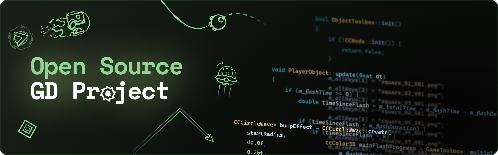

  

<h1 align="center">Manually verified reconstructions of Geometry Dash functions for modders</h1>

Welcome to the Open Source Geometry Dash Project. This is (hopefully) what I plan to be the most reliable source of information for reverse-engineered function implementations. Basically, I like wasting hours of my spare time and making myself suffer just so I can help the GD modding community.

## Verified for accuracy

Complex functions are verified by overriding the original and testing the behavior in-game.

*Note: if you see member variables that don't exist in the Geode bindings, that's because some of were renamed. A list of them can be found in [the markdown file](./RENAMED_BINDINGS.md)*.

## Information

- Game versions: 2.2081, 2.2091
- Software used for reversing: [Hex-Rays IDA Professional 9.3](https://hex-rays.com/ida-pro) with [BromaIDA for symbols](https://github.com/Stazzical/BromaIDA)

## Contribution (please read)

If you are in need of a function's code that isn't already on this list, or want to simply request an addition, please open a PR or message me on discord at @starrydawn72. All pull requests will go through manual confirmation before being added to the repository.
 
 
**Rules for submitting a function** through a pull request:
- Decompilation must be done in IDA, reconstructions using Ghidra will not be accepted
- Its behavior must be tested in-game by overriding the original using a Geode mod
- Member variables featured in [RENAMED_BINDINGS.md](./RENAMED_BINDINGS.md) must use their new name
- The function's opening brace should be on the next line (for consistency)
- Always prefer C-style casts over static_cast to match RobTop's coding style (e.g. `(RingObject*)m_touchingRings->objectAtIndex(i)`)

You should view the existing reconstructions on this repo to get an idea of the style before submission.

## Shortcut links to entries per class

### 2.2091

	
 <b>CCCircleWave ✔️</b>  (11)

	<ul>
		<li><a href="./versions/2.2091/CCCircleWave/baseSetup.cpp">baseSetup</a></li>
		<li><a href="./versions/2.2091/CCCircleWave/CCCircleWave.cpp">CCCircleWave</a></li>
		<li><a href="./versions/2.2091/CCCircleWave/create.cpp">create</a></li>
		<li><a href="./versions/2.2091/CCCircleWave/draw.cpp">draw</a></li>
		<li><a href="./versions/2.2091/CCCircleWave/followObject.cpp">followObject</a></li>
		<li><a href="./versions/2.2091/CCCircleWave/init.cpp">init</a></li>
		<li><a href="./versions/2.2091/CCCircleWave/removeMeAndCleanup.cpp">removeMeAndCleanup</a></li>
		<li><a href="./versions/2.2091/CCCircleWave/setPosition.cpp">setPosition</a></li>
		<li><a href="./versions/2.2091/CCCircleWave/updatePosition.cpp">updatePosition</a></li>
		<li><a href="./versions/2.2091/CCCircleWave/updateTweenAction.cpp">updateTweenAction</a></li>
		<li><a href="./versions/2.2091/CCCircleWave/~CCCircleWave.cpp">~CCCircleWave</a></li>
	</ul>

	
 <b>CCCircleWaveDelegate ✔️</b>  (1)

	<ul>
		<li><a href="./versions/2.2091/CCCircleWaveDelegate/circleWaveWillBeRemoved.cpp">circleWaveWillBeRemoved</a></li>
	</ul>

	
 <b>GJBaseGameLayer</b>  (3)

	<ul>
		<li><a href="./versions/2.2091/GJBaseGameLayer/activateCustomRing.cpp">activateCustomRing</a></li>
		<li><a href="./versions/2.2091/GJBaseGameLayer/getBumpMod.cpp">getBumpMod</a></li>
		<li><a href="./versions/2.2091/GJBaseGameLayer/gravBumpPlayer.cpp">gravBumpPlayer</a></li>
	</ul>

	
 <b>GJFlyGroundLayer ✔️</b>  (1)

	<ul>
		<li><a href="./versions/2.2091/GJFlyGroundLayer/init.cpp">init</a></li>
	</ul>

	
 <b>GravityEffectSprite ✔️</b>  (3)

	<ul>
		<li><a href="./versions/2.2091/GravityEffectSprite/draw.cpp">draw</a></li>
		<li><a href="./versions/2.2091/GravityEffectSprite/init.cpp">init</a></li>
		<li><a href="./versions/2.2091/GravityEffectSprite/updateSpritesColor.cpp">updateSpritesColor</a></li>
	</ul>

	
 <b>PlayerFireBoostSprite ✔️</b>  (4)

	<ul>
		<li><a href="./versions/2.2091/PlayerFireBoostSprite/animateFireIn.cpp">animateFireIn</a></li>
		<li><a href="./versions/2.2091/PlayerFireBoostSprite/animateFireOut.cpp">animateFireOut</a></li>
		<li><a href="./versions/2.2091/PlayerFireBoostSprite/init.cpp">init</a></li>
		<li><a href="./versions/2.2091/PlayerFireBoostSprite/loopFireAnimation.cpp">loopFireAnimation</a></li>
	</ul>

	
 <b>PlayerObject</b>  (188)

	<ul>
		<li><a href="./versions/2.2091/PlayerObject/addAllParticles.cpp">addAllParticles</a></li>
		<li><a href="./versions/2.2091/PlayerObject/addToTouchedRings.cpp">addToTouchedRings</a></li>
		<li><a href="./versions/2.2091/PlayerObject/addToYVelocity.cpp">addToYVelocity</a></li>
		<li><a href="./versions/2.2091/PlayerObject/animatePlatformerJump.cpp">animatePlatformerJump</a></li>
		<li><a href="./versions/2.2091/PlayerObject/animationFinished.cpp">animationFinished</a></li>
		<li><a href="./versions/2.2091/PlayerObject/boostPlayer.cpp">boostPlayer</a></li>
		<li><a href="./versions/2.2091/PlayerObject/bumpPlayer.cpp">bumpPlayer</a></li>
		<li><a href="./versions/2.2091/PlayerObject/buttonDown.cpp">buttonDown</a></li>
		<li><a href="./versions/2.2091/PlayerObject/canStickToGround.cpp">canStickToGround</a></li>
		<li><a href="./versions/2.2091/PlayerObject/checkSnapJumpToObject.cpp">checkSnapJumpToObject</a></li>
		<li><a href="./versions/2.2091/PlayerObject/collidedWithObject.cpp">collidedWithObject</a></li>
		<li><a href="./versions/2.2091/PlayerObject/collidedWithSlope.cpp">collidedWithSlope</a></li>
		<li><a href="./versions/2.2091/PlayerObject/collidedWithSlopeInternal.cpp">collidedWithSlopeInternal</a></li>
		<li><a href="./versions/2.2091/PlayerObject/convertToClosestRotation.cpp">convertToClosestRotation</a></li>
		<li><a href="./versions/2.2091/PlayerObject/copyAttributes.cpp">copyAttributes</a></li>
		<li><a href="./versions/2.2091/PlayerObject/create.cpp">create</a></li>
		<li><a href="./versions/2.2091/PlayerObject/createFadeOutDartStreak.cpp">createFadeOutDartStreak</a></li>
		<li><a href="./versions/2.2091/PlayerObject/createRobot.cpp">createRobot</a></li>
		<li><a href="./versions/2.2091/PlayerObject/createSpider.cpp">createSpider</a></li>
		<li><a href="./versions/2.2091/PlayerObject/deactivateParticle.cpp">deactivateParticle</a></li>
		<li><a href="./versions/2.2091/PlayerObject/deactivateStreak.cpp">deactivateStreak</a></li>
		<li><a href="./versions/2.2091/PlayerObject/destroyFromHitHead.cpp">destroyFromHitHead</a></li>
		<li><a href="./versions/2.2091/PlayerObject/didHitHead.cpp">didHitHead</a></li>
		<li><a href="./versions/2.2091/PlayerObject/disableCustomGlowColor.cpp">disableCustomGlowColor</a></li>
		<li><a href="./versions/2.2091/PlayerObject/disablePlayerControls.cpp">disablePlayerControls</a></li>
		<li><a href="./versions/2.2091/PlayerObject/disableSwingFire.cpp">disableSwingFire</a></li>
		<li><a href="./versions/2.2091/PlayerObject/doReversePlayer.cpp">doReversePlayer</a></li>
		<li><a href="./versions/2.2091/PlayerObject/enableCustomGlowColor.cpp">enableCustomGlowColor</a></li>
		<li><a href="./versions/2.2091/PlayerObject/exitPlatformerAnimateJump.cpp">exitPlatformerAnimateJump</a></li>
		<li><a href="./versions/2.2091/PlayerObject/fadeOutStreak2.cpp">fadeOutStreak2</a></li>
		<li><a href="./versions/2.2091/PlayerObject/flashPlayer.cpp">flashPlayer</a></li>
		<li><a href="./versions/2.2091/PlayerObject/flipGravity.cpp">flipGravity</a></li>
		<li><a href="./versions/2.2091/PlayerObject/flipMod.cpp">flipMod</a></li>
		<li><a href="./versions/2.2091/PlayerObject/gameEventTriggered.cpp">gameEventTriggered</a></li>
		<li><a href="./versions/2.2091/PlayerObject/getActiveMode.cpp">getActiveMode</a></li>
		<li><a href="./versions/2.2091/PlayerObject/getCurrentXVelocity.cpp">getCurrentXVelocity</a></li>
		<li><a href="./versions/2.2091/PlayerObject/getModifiedSlopeYVel.cpp">getModifiedSlopeYVel</a></li>
		<li><a href="./versions/2.2091/PlayerObject/getObjectRotation.cpp">getObjectRotation</a></li>
		<li><a href="./versions/2.2091/PlayerObject/getOldPosition.cpp">getOldPosition</a></li>
		<li><a href="./versions/2.2091/PlayerObject/getOrientedBox.cpp">getOrientedBox</a></li>
		<li><a href="./versions/2.2091/PlayerObject/getRealPosition.cpp">getRealPosition</a></li>
		<li><a href="./versions/2.2091/PlayerObject/getSecondColor.cpp">getSecondColor</a></li>
		<li><a href="./versions/2.2091/PlayerObject/getYVelocity.cpp">getYVelocity</a></li>
		<li><a href="./versions/2.2091/PlayerObject/gravityDown.cpp">gravityDown</a></li>
		<li><a href="./versions/2.2091/PlayerObject/gravityUp.cpp">gravityUp</a></li>
		<li><a href="./versions/2.2091/PlayerObject/handlePlayerCommand.cpp">handlePlayerCommand</a></li>
		<li><a href="./versions/2.2091/PlayerObject/handleRotatedCollisionInternal.cpp">handleRotatedCollisionInternal</a></li>
		<li><a href="./versions/2.2091/PlayerObject/handleRotatedObjectCollision.cpp">handleRotatedObjectCollision</a></li>
		<li><a href="./versions/2.2091/PlayerObject/handleRotatedSlopeCollision.cpp">handleRotatedSlopeCollision</a></li>
		<li><a href="./versions/2.2091/PlayerObject/hardFlipGravity.cpp">hardFlipGravity</a></li>
		<li><a href="./versions/2.2091/PlayerObject/hitGround.cpp">hitGround</a></li>
		<li><a href="./versions/2.2091/PlayerObject/hitGroundNoJump.cpp">hitGroundNoJump</a></li>
		<li><a href="./versions/2.2091/PlayerObject/incrementJumps.cpp">incrementJumps</a></li>
		<li><a href="./versions/2.2091/PlayerObject/isBoostValid.cpp">isBoostValid</a></li>
		<li><a href="./versions/2.2091/PlayerObject/isFlying.cpp">isFlying</a></li>
		<li><a href="./versions/2.2091/PlayerObject/isInBasicMode.cpp">isInBasicMode</a></li>
		<li><a href="./versions/2.2091/PlayerObject/isInNormalMode.cpp">isInNormalMode</a></li>
		<li><a href="./versions/2.2091/PlayerObject/isSafeFlip.cpp">isSafeFlip</a></li>
		<li><a href="./versions/2.2091/PlayerObject/isSafeHeadTest.cpp">isSafeHeadTest</a></li>
		<li><a href="./versions/2.2091/PlayerObject/isSafeMode.cpp">isSafeMode</a></li>
		<li><a href="./versions/2.2091/PlayerObject/isSafeSpiderFlip.cpp">isSafeSpiderFlip</a></li>
		<li><a href="./versions/2.2091/PlayerObject/levelFlipFinished.cpp">levelFlipFinished</a></li>
		<li><a href="./versions/2.2091/PlayerObject/levelFlipping.cpp">levelFlipping</a></li>
		<li><a href="./versions/2.2091/PlayerObject/levelWillFlip.cpp">levelWillFlip</a></li>
		<li><a href="./versions/2.2091/PlayerObject/limitDashRotation.cpp">limitDashRotation</a></li>
		<li><a href="./versions/2.2091/PlayerObject/lockPlayer.cpp">lockPlayer</a></li>
		<li><a href="./versions/2.2091/PlayerObject/logValues.cpp">logValues</a></li>
		<li><a href="./versions/2.2091/PlayerObject/modeDidChange.cpp">modeDidChange</a></li>
		<li><a href="./versions/2.2091/PlayerObject/playBumpEffect.cpp">playBumpEffect</a></li>
		<li><a href="./versions/2.2091/PlayerObject/playBurstEffect.cpp">playBurstEffect</a></li>
		<li><a href="./versions/2.2091/PlayerObject/playCompleteEffect.cpp">playCompleteEffect</a></li>
		<li><a href="./versions/2.2091/PlayerObject/playDynamicSpiderRun.cpp">playDynamicSpiderRun</a></li>
		<li><a href="./versions/2.2091/PlayerObject/playerDestroyed.cpp">playerDestroyed</a></li>
		<li><a href="./versions/2.2091/PlayerObject/playerIsFalling.cpp">playerIsFalling</a></li>
		<li><a href="./versions/2.2091/PlayerObject/playerIsFallingBugged.cpp">playerIsFallingBugged</a></li>
		<li><a href="./versions/2.2091/PlayerObject/playerIsMovingUp.cpp">playerIsMovingUp</a></li>
		<li><a href="./versions/2.2091/PlayerObject/playerTeleported.cpp">playerTeleported</a></li>
		<li><a href="./versions/2.2091/PlayerObject/playingEndEffect.cpp">playingEndEffect</a></li>
		<li><a href="./versions/2.2091/PlayerObject/playSpawnEffect.cpp">playSpawnEffect</a></li>
		<li><a href="./versions/2.2091/PlayerObject/playSpiderDashEffect.cpp">playSpiderDashEffect</a></li>
		<li><a href="./versions/2.2091/PlayerObject/preCollision.cpp">preCollision</a></li>
		<li><a href="./versions/2.2091/PlayerObject/preSlopeCollision.cpp">preSlopeCollision</a></li>
		<li><a href="./versions/2.2091/PlayerObject/propellPlayer.cpp">propellPlayer</a></li>
		<li><a href="./versions/2.2091/PlayerObject/pushDown.cpp">pushDown</a></li>
		<li><a href="./versions/2.2091/PlayerObject/pushPlayer.cpp">pushPlayer</a></li>
		<li><a href="./versions/2.2091/PlayerObject/redirectDash.cpp">redirectDash</a></li>
		<li><a href="./versions/2.2091/PlayerObject/releaseAllButtons.cpp">releaseAllButtons</a></li>
		<li><a href="./versions/2.2091/PlayerObject/releaseButton.cpp">releaseButton</a></li>
		<li><a href="./versions/2.2091/PlayerObject/removeAllParticles.cpp">removeAllParticles</a></li>
		<li><a href="./versions/2.2091/PlayerObject/removePendingCheckpoint.cpp">removePendingCheckpoint</a></li>
		<li><a href="./versions/2.2091/PlayerObject/removePlacedCheckpoint.cpp">removePlacedCheckpoint</a></li>
		<li><a href="./versions/2.2091/PlayerObject/resetAllParticles.cpp">resetAllParticles</a></li>
		<li><a href="./versions/2.2091/PlayerObject/resetCollisionLog.cpp">resetCollisionLog</a></li>
		<li><a href="./versions/2.2091/PlayerObject/resetCollisionValues.cpp">resetCollisionValues</a></li>
		<li><a href="./versions/2.2091/PlayerObject/resetPlayerIcon.cpp">resetPlayerIcon</a></li>
		<li><a href="./versions/2.2091/PlayerObject/resetStateVariables.cpp">resetStateVariables</a></li>
		<li><a href="./versions/2.2091/PlayerObject/resetStreak.cpp">resetStreak</a></li>
		<li><a href="./versions/2.2091/PlayerObject/resetTouchedRings.cpp">resetTouchedRings</a></li>
		<li><a href="./versions/2.2091/PlayerObject/reverseMod.cpp">reverseMod</a></li>
		<li><a href="./versions/2.2091/PlayerObject/reversePlayer.cpp">reversePlayer</a></li>
		<li><a href="./versions/2.2091/PlayerObject/ringJump.cpp">ringJump</a></li>
		<li><a href="./versions/2.2091/PlayerObject/rotateGameplay.cpp">rotateGameplay</a></li>
		<li><a href="./versions/2.2091/PlayerObject/rotateGameplayObject.cpp">rotateGameplayObject</a></li>
		<li><a href="./versions/2.2091/PlayerObject/rotateGameplayOnly.cpp">rotateGameplayOnly</a></li>
		<li><a href="./versions/2.2091/PlayerObject/rotatePreSlopeObjects.cpp">rotatePreSlopeObjects</a></li>
		<li><a href="./versions/2.2091/PlayerObject/runBallRotation.cpp">runBallRotation</a></li>
		<li><a href="./versions/2.2091/PlayerObject/runBallRotation2.cpp">runBallRotation2</a></li>
		<li><a href="./versions/2.2091/PlayerObject/runNormalRotation.cpp">runNormalRotation</a></li>
		<li><a href="./versions/2.2091/PlayerObject/runRotateAction.cpp">runRotateAction</a></li>
		<li><a href="./versions/2.2091/PlayerObject/setColor.cpp">setColor</a></li>
		<li><a href="./versions/2.2091/PlayerObject/setFlipX.cpp">setFlipX</a></li>
		<li><a href="./versions/2.2091/PlayerObject/setFlipY.cpp">setFlipY</a></li>
		<li><a href="./versions/2.2091/PlayerObject/setOpacity.cpp">setOpacity</a></li>
		<li><a href="./versions/2.2091/PlayerObject/setRotation.cpp">setRotation</a></li>
		<li><a href="./versions/2.2091/PlayerObject/setScale.cpp">setScale</a></li>
		<li><a href="./versions/2.2091/PlayerObject/setScaleX.cpp">setScaleX</a></li>
		<li><a href="./versions/2.2091/PlayerObject/setScaleY.cpp">setScaleY</a></li>
		<li><a href="./versions/2.2091/PlayerObject/setSecondColor.cpp">setSecondColor</a></li>
		<li><a href="./versions/2.2091/PlayerObject/setupStreak.cpp">setupStreak</a></li>
		<li><a href="./versions/2.2091/PlayerObject/setVisible.cpp">setVisible</a></li>
		<li><a href="./versions/2.2091/PlayerObject/setYVelocity.cpp">setYVelocity</a></li>
		<li><a href="./versions/2.2091/PlayerObject/spawnCircle.cpp">spawnCircle</a></li>
		<li><a href="./versions/2.2091/PlayerObject/spawnCircle2.cpp">spawnCircle2</a></li>
		<li><a href="./versions/2.2091/PlayerObject/spawnDualCircle.cpp">spawnDualCircle</a></li>
		<li><a href="./versions/2.2091/PlayerObject/spawnFromPlayer.cpp">spawnFromPlayer</a></li>
		<li><a href="./versions/2.2091/PlayerObject/spawnPortalCircle.cpp">spawnPortalCircle</a></li>
		<li><a href="./versions/2.2091/PlayerObject/specialGroundHit.cpp">specialGroundHit</a></li>
		<li><a href="./versions/2.2091/PlayerObject/speedDown.cpp">speedDown</a></li>
		<li><a href="./versions/2.2091/PlayerObject/speedUp.cpp">speedUp</a></li>
		<li><a href="./versions/2.2091/PlayerObject/spiderTestJump.cpp">spiderTestJump</a></li>
		<li><a href="./versions/2.2091/PlayerObject/spiderTestJumpInternal.cpp">spiderTestJumpInternal</a></li>
		<li><a href="./versions/2.2091/PlayerObject/stopBurstEffect.cpp">stopBurstEffect</a></li>
		<li><a href="./versions/2.2091/PlayerObject/stopDashing.cpp">stopDashing</a></li>
		<li><a href="./versions/2.2091/PlayerObject/stopParticles.cpp">stopParticles</a></li>
		<li><a href="./versions/2.2091/PlayerObject/stopPlatformerJumpAnimation.cpp">stopPlatformerJumpAnimation</a></li>
		<li><a href="./versions/2.2091/PlayerObject/stopRotation.cpp">stopRotation</a></li>
		<li><a href="./versions/2.2091/PlayerObject/stopStreak2.cpp">stopStreak2</a></li>
		<li><a href="./versions/2.2091/PlayerObject/storeCollision.cpp">storeCollision</a></li>
		<li><a href="./versions/2.2091/PlayerObject/switchedToMode.cpp">switchedToMode</a></li>
		<li><a href="./versions/2.2091/PlayerObject/testForMoving.cpp">testForMoving</a></li>
		<li><a href="./versions/2.2091/PlayerObject/toggleBirdMode.cpp">toggleBirdMode</a></li>
		<li><a href="./versions/2.2091/PlayerObject/toggleDartMode.cpp">toggleDartMode</a></li>
		<li><a href="./versions/2.2091/PlayerObject/toggleFlyMode.cpp">toggleFlyMode</a></li>
		<li><a href="./versions/2.2091/PlayerObject/toggleGhostEffect.cpp">toggleGhostEffect</a></li>
		<li><a href="./versions/2.2091/PlayerObject/togglePlatformerMode.cpp">togglePlatformerMode</a></li>
		<li><a href="./versions/2.2091/PlayerObject/toggleRobotMode.cpp">toggleRobotMode</a></li>
		<li><a href="./versions/2.2091/PlayerObject/toggleRollMode.cpp">toggleRollMode</a></li>
		<li><a href="./versions/2.2091/PlayerObject/toggleSpiderMode.cpp">toggleSpiderMode</a></li>
		<li><a href="./versions/2.2091/PlayerObject/toggleSwingMode.cpp">toggleSwingMode</a></li>
		<li><a href="./versions/2.2091/PlayerObject/toggleVisibility.cpp">toggleVisibility</a></li>
		<li><a href="./versions/2.2091/PlayerObject/touchedObject.cpp">touchedObject</a></li>
		<li><a href="./versions/2.2091/PlayerObject/unrotateGameplayObject.cpp">unrotateGameplayObject</a></li>
		<li><a href="./versions/2.2091/PlayerObject/unrotatePreSlopeObjects.cpp">unrotatePreSlopeObjects</a></li>
		<li><a href="./versions/2.2091/PlayerObject/updateCheckpointMode.cpp">updateCheckpointMode</a></li>
		<li><a href="./versions/2.2091/PlayerObject/updateCollide.cpp">updateCollide</a></li>
		<li><a href="./versions/2.2091/PlayerObject/updateCollideBottom.cpp">updateCollideBottom</a></li>
		<li><a href="./versions/2.2091/PlayerObject/updateCollideLeft.cpp">updateCollideLeft</a></li>
		<li><a href="./versions/2.2091/PlayerObject/updateCollideRight.cpp">updateCollideRight</a></li>
		<li><a href="./versions/2.2091/PlayerObject/updateCollideTop.cpp">updateCollideTop</a></li>
		<li><a href="./versions/2.2091/PlayerObject/updateEffects.cpp">updateEffects</a></li>
		<li><a href="./versions/2.2091/PlayerObject/updateInternalActions.cpp">updateInternalActions</a></li>
		<li><a href="./versions/2.2091/PlayerObject/updateJumpVariables.cpp">updateJumpVariables</a></li>
		<li><a href="./versions/2.2091/PlayerObject/updateLastGroundObject.cpp">updateLastGroundObject</a></li>
		<li><a href="./versions/2.2091/PlayerObject/updatePlayerArt.cpp">updatePlayerArt</a></li>
		<li><a href="./versions/2.2091/PlayerObject/updatePlayerBirdFrame.cpp">updatePlayerBirdFrame</a></li>
		<li><a href="./versions/2.2091/PlayerObject/updatePlayerDartFrame.cpp">updatePlayerDartFrame</a></li>
		<li><a href="./versions/2.2091/PlayerObject/updatePlayerForce.cpp">updatePlayerForce</a></li>
		<li><a href="./versions/2.2091/PlayerObject/updatePlayerFrame.cpp">updatePlayerFrame</a></li>
		<li><a href="./versions/2.2091/PlayerObject/updatePlayerJetpackFrame.cpp">updatePlayerJetpackFrame</a></li>
		<li><a href="./versions/2.2091/PlayerObject/updatePlayerRobotFrame.cpp">updatePlayerRobotFrame</a></li>
		<li><a href="./versions/2.2091/PlayerObject/updatePlayerRollFrame.cpp">updatePlayerRollFrame</a></li>
		<li><a href="./versions/2.2091/PlayerObject/updatePlayerScale.cpp">updatePlayerScale</a></li>
		<li><a href="./versions/2.2091/PlayerObject/updatePlayerShipFrame.cpp">updatePlayerShipFrame</a></li>
		<li><a href="./versions/2.2091/PlayerObject/updatePlayerSpiderFrame.cpp">updatePlayerSpiderFrame</a></li>
		<li><a href="./versions/2.2091/PlayerObject/updatePlayerSpriteExtra.cpp">updatePlayerSpriteExtra</a></li>
		<li><a href="./versions/2.2091/PlayerObject/updatePlayerSwingFrame.cpp">updatePlayerSwingFrame</a></li>
		<li><a href="./versions/2.2091/PlayerObject/updateRobotAnimationSpeed.cpp">updateRobotAnimationSpeed</a></li>
		<li><a href="./versions/2.2091/PlayerObject/updateShipRotation.cpp">updateShipRotation</a></li>
		<li><a href="./versions/2.2091/PlayerObject/updateShipSpriteExtra.cpp">updateShipSpriteExtra</a></li>
		<li><a href="./versions/2.2091/PlayerObject/updateSlopeRotation.cpp">updateSlopeRotation</a></li>
		<li><a href="./versions/2.2091/PlayerObject/updateSlopeYVelocity.cpp">updateSlopeYVelocity</a></li>
		<li><a href="./versions/2.2091/PlayerObject/updateStaticForce.cpp">updateStaticForce</a></li>
		<li><a href="./versions/2.2091/PlayerObject/updateStreaks.cpp">updateStreaks</a></li>
		<li><a href="./versions/2.2091/PlayerObject/updateSwingFire.cpp">updateSwingFire</a></li>
		<li><a href="./versions/2.2091/PlayerObject/updateTimeMod.cpp">updateTimeMod</a></li>
		<li><a href="./versions/2.2091/PlayerObject/usingWallLimitedMode.cpp">usingWallLimitedMode</a></li>
		<li><a href="./versions/2.2091/PlayerObject/yStartDown.cpp">yStartDown</a></li>
		<li><a href="./versions/2.2091/PlayerObject/yStartUp.cpp">yStartUp</a></li>
	</ul>

        
 <b>Other</b> (1)

        <ul>
            <li><a href="./versions/2.2091/FreeFunctions.cpp">Free Functions</a></li>
        </ul>
    

    
### 2.2081

	
 <b>AnimatedShopKeeper ✔️</b>  (5)

	<ul>
		<li><a href="./versions/2.2081/AnimatedShopKeeper/animationFinished.cpp">animationFinished</a></li>
		<li><a href="./versions/2.2081/AnimatedShopKeeper/create.cpp">create</a></li>
		<li><a href="./versions/2.2081/AnimatedShopKeeper/init.cpp">init</a></li>
		<li><a href="./versions/2.2081/AnimatedShopKeeper/playReactAnimation.cpp">playReactAnimation</a></li>
		<li><a href="./versions/2.2081/AnimatedShopKeeper/startAnimating.cpp">startAnimating</a></li>
	</ul>

	
 <b>AudioEffectsLayer</b>  (1)

	<ul>
		<li><a href="./versions/2.2081/AudioEffectsLayer/audioStep.cpp">audioStep</a></li>
	</ul>

	
 <b>CCCircleWave ✔️</b>  (11)

	<ul>
		<li><a href="./versions/2.2081/CCCircleWave/baseSetup.cpp">baseSetup</a></li>
		<li><a href="./versions/2.2081/CCCircleWave/CCCircleWave.cpp">CCCircleWave</a></li>
		<li><a href="./versions/2.2081/CCCircleWave/create.cpp">create</a></li>
		<li><a href="./versions/2.2081/CCCircleWave/draw.cpp">draw</a></li>
		<li><a href="./versions/2.2081/CCCircleWave/followObject.cpp">followObject</a></li>
		<li><a href="./versions/2.2081/CCCircleWave/init.cpp">init</a></li>
		<li><a href="./versions/2.2081/CCCircleWave/removeMeAndCleanup.cpp">removeMeAndCleanup</a></li>
		<li><a href="./versions/2.2081/CCCircleWave/setPosition.cpp">setPosition</a></li>
		<li><a href="./versions/2.2081/CCCircleWave/updatePosition.cpp">updatePosition</a></li>
		<li><a href="./versions/2.2081/CCCircleWave/updateTweenAction.cpp">updateTweenAction</a></li>
		<li><a href="./versions/2.2081/CCCircleWave/~CCCircleWave.cpp">~CCCircleWave</a></li>
	</ul>

	
 <b>CCCircleWaveDelegate ✔️</b>  (1)

	<ul>
		<li><a href="./versions/2.2081/CCCircleWaveDelegate/circleWaveWillBeRemoved.cpp">circleWaveWillBeRemoved</a></li>
	</ul>

	
 <b>EditorUI</b>  (1)

	<ul>
		<li><a href="./versions/2.2081/EditorUI/deselectObject.cpp">deselectObject</a></li>
	</ul>

	
 <b>GameLevelManager</b>  (1)

	<ul>
		<li><a href="./versions/2.2081/GameLevelManager/downloadLevel.cpp">downloadLevel</a></li>
	</ul>

	
 <b>GameObject</b>  (6)

	<ul>
		<li><a href="./versions/2.2081/GameObject/createAndAddParticle.cpp">createAndAddParticle</a></li>
		<li><a href="./versions/2.2081/GameObject/getObjectRect.cpp">getObjectRect</a></li>
		<li><a href="./versions/2.2081/GameObject/getObjectRect2.cpp">getObjectRect2</a></li>
		<li><a href="./versions/2.2081/GameObject/getObjectRectDirty.cpp">getObjectRectDirty</a></li>
		<li><a href="./versions/2.2081/GameObject/getObjectRectPointer.cpp">getObjectRectPointer</a></li>
		<li><a href="./versions/2.2081/GameObject/slopeYPos.cpp">slopeYPos</a></li>
	</ul>

	
 <b>GJBaseGameLayer</b>  (7)

	<ul>
		<li><a href="./versions/2.2081/GJBaseGameLayer/bumpPlayer.cpp">bumpPlayer</a></li>
		<li><a href="./versions/2.2081/GJBaseGameLayer/collisionCheckObjects.cpp">collisionCheckObjects</a></li>
		<li><a href="./versions/2.2081/GJBaseGameLayer/createBackground.cpp">createBackground</a></li>
		<li><a href="./versions/2.2081/GJBaseGameLayer/objectIntersectsCircle.cpp">objectIntersectsCircle</a></li>
		<li><a href="./versions/2.2081/GJBaseGameLayer/playerCircleCollision.cpp">playerCircleCollision</a></li>
		<li><a href="./versions/2.2081/GJBaseGameLayer/playerIntersectsCircle.cpp">playerIntersectsCircle</a></li>
		<li><a href="./versions/2.2081/GJBaseGameLayer/updateCameraBGArt.cpp">updateCameraBGArt</a></li>
	</ul>

	
 <b>GJFlyGroundLayer ✔️</b>  (1)

	<ul>
		<li><a href="./versions/2.2081/GJFlyGroundLayer/init.cpp">init</a></li>
	</ul>

	
 <b>GJGroundLayer ✔️</b>  (23)

	<ul>
		<li><a href="./versions/2.2081/GJGroundLayer/create.cpp">create</a></li>
		<li><a href="./versions/2.2081/GJGroundLayer/createLine.cpp">createLine</a></li>
		<li><a href="./versions/2.2081/GJGroundLayer/deactivateGround.cpp">deactivateGround</a></li>
		<li><a href="./versions/2.2081/GJGroundLayer/draw.cpp">draw</a></li>
		<li><a href="./versions/2.2081/GJGroundLayer/fadeInFinished.cpp">fadeInFinished</a></li>
		<li><a href="./versions/2.2081/GJGroundLayer/fadeInGround.cpp">fadeInGround</a></li>
		<li><a href="./versions/2.2081/GJGroundLayer/fadeOutGround.cpp">fadeOutGround</a></li>
		<li><a href="./versions/2.2081/GJGroundLayer/getGroundY.cpp">getGroundY</a></li>
		<li><a href="./versions/2.2081/GJGroundLayer/hideShadows.cpp">hideShadows</a></li>
		<li><a href="./versions/2.2081/GJGroundLayer/init.cpp">init</a></li>
		<li><a href="./versions/2.2081/GJGroundLayer/loadGroundSprites.cpp">loadGroundSprites</a></li>
		<li><a href="./versions/2.2081/GJGroundLayer/positionGround.cpp">positionGround</a></li>
		<li><a href="./versions/2.2081/GJGroundLayer/scaleGround.cpp">scaleGround</a></li>
		<li><a href="./versions/2.2081/GJGroundLayer/showGround.cpp">showGround</a></li>
		<li><a href="./versions/2.2081/GJGroundLayer/toggleVisible01.cpp">toggleVisible01</a></li>
		<li><a href="./versions/2.2081/GJGroundLayer/toggleVisible02.cpp">toggleVisible02</a></li>
		<li><a href="./versions/2.2081/GJGroundLayer/updateGround01Color.cpp">updateGround01Color</a></li>
		<li><a href="./versions/2.2081/GJGroundLayer/updateGround02Color.cpp">updateGround02Color</a></li>
		<li><a href="./versions/2.2081/GJGroundLayer/updateGroundPos.cpp">updateGroundPos</a></li>
		<li><a href="./versions/2.2081/GJGroundLayer/updateGroundWidth.cpp">updateGroundWidth</a></li>
		<li><a href="./versions/2.2081/GJGroundLayer/updateLineBlend.cpp">updateLineBlend</a></li>
		<li><a href="./versions/2.2081/GJGroundLayer/updateShadows.cpp">updateShadows</a></li>
		<li><a href="./versions/2.2081/GJGroundLayer/updateShadowXPos.cpp">updateShadowXPos</a></li>
	</ul>

	
 <b>HardStreak</b>  (13)

	<ul>
		<li><a href="./versions/2.2081/HardStreak/addPoint.cpp">addPoint</a></li>
		<li><a href="./versions/2.2081/HardStreak/clearAboveXPos.cpp">clearAboveXPos</a></li>
		<li><a href="./versions/2.2081/HardStreak/clearBehindXPos.cpp">clearBehindXPos</a></li>
		<li><a href="./versions/2.2081/HardStreak/firstSetup.cpp">firstSetup</a></li>
		<li><a href="./versions/2.2081/HardStreak/HardStreak.cpp">HardStreak</a></li>
		<li><a href="./versions/2.2081/HardStreak/init.cpp">init</a></li>
		<li><a href="./versions/2.2081/HardStreak/normalizeAngle.cpp">normalizeAngle</a></li>
		<li><a href="./versions/2.2081/HardStreak/quadCornerOffset.cpp">quadCornerOffset</a></li>
		<li><a href="./versions/2.2081/HardStreak/reset.cpp">reset</a></li>
		<li><a href="./versions/2.2081/HardStreak/resumeStroke.cpp">resumeStroke</a></li>
		<li><a href="./versions/2.2081/HardStreak/scheduleAutoUpdate.cpp">scheduleAutoUpdate</a></li>
		<li><a href="./versions/2.2081/HardStreak/stopStroke.cpp">stopStroke</a></li>
		<li><a href="./versions/2.2081/HardStreak/updateStroke.cpp">updateStroke</a></li>
	</ul>

	
 <b>LevelEditorLayer</b>  (2)

	<ul>
		<li><a href="./versions/2.2081/LevelEditorLayer/addObjectFromVector.cpp">addObjectFromVector</a></li>
		<li><a href="./versions/2.2081/LevelEditorLayer/updateVisibility.cpp">updateVisibility</a></li>
	</ul>

	
 <b>LevelInfoLayer</b>  (6)

	<ul>
		<li><a href="./versions/2.2081/LevelInfoLayer/loadLevelStep.cpp">loadLevelStep</a></li>
		<li><a href="./versions/2.2081/LevelInfoLayer/onPlay.cpp">onPlay</a></li>
		<li><a href="./versions/2.2081/LevelInfoLayer/playStep2.cpp">playStep2</a></li>
		<li><a href="./versions/2.2081/LevelInfoLayer/playStep3.cpp">playStep3</a></li>
		<li><a href="./versions/2.2081/LevelInfoLayer/playStep4.cpp">playStep4</a></li>
		<li><a href="./versions/2.2081/LevelInfoLayer/showSongWarning.cpp">showSongWarning</a></li>
	</ul>

	
 <b>ObjectToolbox</b>  (1)

	<ul>
		<li><a href="./versions/2.2081/ObjectToolbox/init.cpp">init</a></li>
	</ul>

	
 <b>PlayerObject</b>  (197)

	<ul>
		<li><a href="./versions/2.2081/PlayerObject/activateStreak.cpp">activateStreak</a></li>
		<li><a href="./versions/2.2081/PlayerObject/addAllParticles.cpp">addAllParticles</a></li>
		<li><a href="./versions/2.2081/PlayerObject/addToTouchedRings.cpp">addToTouchedRings</a></li>
		<li><a href="./versions/2.2081/PlayerObject/addToYVelocity.cpp">addToYVelocity</a></li>
		<li><a href="./versions/2.2081/PlayerObject/animatePlatformerJump.cpp">animatePlatformerJump</a></li>
		<li><a href="./versions/2.2081/PlayerObject/animationFinished.cpp">animationFinished</a></li>
		<li><a href="./versions/2.2081/PlayerObject/boostPlayer.cpp">boostPlayer</a></li>
		<li><a href="./versions/2.2081/PlayerObject/bumpPlayer.cpp">bumpPlayer</a></li>
		<li><a href="./versions/2.2081/PlayerObject/buttonDown.cpp">buttonDown</a></li>
		<li><a href="./versions/2.2081/PlayerObject/canStickToGround.cpp">canStickToGround</a></li>
		<li><a href="./versions/2.2081/PlayerObject/checkSnapJumpToObject.cpp">checkSnapJumpToObject</a></li>
		<li><a href="./versions/2.2081/PlayerObject/collidedWithObject.cpp">collidedWithObject</a></li>
		<li><a href="./versions/2.2081/PlayerObject/collidedWithSlope.cpp">collidedWithSlope</a></li>
		<li><a href="./versions/2.2081/PlayerObject/collidedWithSlopeInternal.cpp">collidedWithSlopeInternal</a></li>
		<li><a href="./versions/2.2081/PlayerObject/convertToClosestRotation.cpp">convertToClosestRotation</a></li>
		<li><a href="./versions/2.2081/PlayerObject/copyAttributes.cpp">copyAttributes</a></li>
		<li><a href="./versions/2.2081/PlayerObject/create.cpp">create</a></li>
		<li><a href="./versions/2.2081/PlayerObject/createFadeOutDartStreak.cpp">createFadeOutDartStreak</a></li>
		<li><a href="./versions/2.2081/PlayerObject/createRobot.cpp">createRobot</a></li>
		<li><a href="./versions/2.2081/PlayerObject/createSpider.cpp">createSpider</a></li>
		<li><a href="./versions/2.2081/PlayerObject/deactivateParticle.cpp">deactivateParticle</a></li>
		<li><a href="./versions/2.2081/PlayerObject/deactivateStreak.cpp">deactivateStreak</a></li>
		<li><a href="./versions/2.2081/PlayerObject/destroyFromHitHead.cpp">destroyFromHitHead</a></li>
		<li><a href="./versions/2.2081/PlayerObject/didHitHead.cpp">didHitHead</a></li>
		<li><a href="./versions/2.2081/PlayerObject/disableCustomGlowColor.cpp">disableCustomGlowColor</a></li>
		<li><a href="./versions/2.2081/PlayerObject/disablePlayerControls.cpp">disablePlayerControls</a></li>
		<li><a href="./versions/2.2081/PlayerObject/disableSwingFire.cpp">disableSwingFire</a></li>
		<li><a href="./versions/2.2081/PlayerObject/doReversePlayer.cpp">doReversePlayer</a></li>
		<li><a href="./versions/2.2081/PlayerObject/enableCustomGlowColor.cpp">enableCustomGlowColor</a></li>
		<li><a href="./versions/2.2081/PlayerObject/exitPlatformerAnimateJump.cpp">exitPlatformerAnimateJump</a></li>
		<li><a href="./versions/2.2081/PlayerObject/fadeOutStreak2.cpp">fadeOutStreak2</a></li>
		<li><a href="./versions/2.2081/PlayerObject/flashPlayer.cpp">flashPlayer</a></li>
		<li><a href="./versions/2.2081/PlayerObject/flipGravity.cpp">flipGravity</a></li>
		<li><a href="./versions/2.2081/PlayerObject/flipMod.cpp">flipMod</a></li>
		<li><a href="./versions/2.2081/PlayerObject/gameEventTriggered.cpp">gameEventTriggered</a></li>
		<li><a href="./versions/2.2081/PlayerObject/getActiveMode.cpp">getActiveMode</a></li>
		<li><a href="./versions/2.2081/PlayerObject/getCurrentXVelocity.cpp">getCurrentXVelocity</a></li>
		<li><a href="./versions/2.2081/PlayerObject/getModifiedSlopeYVel.cpp">getModifiedSlopeYVel</a></li>
		<li><a href="./versions/2.2081/PlayerObject/getObjectRotation.cpp">getObjectRotation</a></li>
		<li><a href="./versions/2.2081/PlayerObject/getOldPosition.cpp">getOldPosition</a></li>
		<li><a href="./versions/2.2081/PlayerObject/getOrientedBox.cpp">getOrientedBox</a></li>
		<li><a href="./versions/2.2081/PlayerObject/getRealPosition.cpp">getRealPosition</a></li>
		<li><a href="./versions/2.2081/PlayerObject/getSecondColor.cpp">getSecondColor</a></li>
		<li><a href="./versions/2.2081/PlayerObject/getYVelocity.cpp">getYVelocity</a></li>
		<li><a href="./versions/2.2081/PlayerObject/gravityDown.cpp">gravityDown</a></li>
		<li><a href="./versions/2.2081/PlayerObject/gravityUp.cpp">gravityUp</a></li>
		<li><a href="./versions/2.2081/PlayerObject/handlePlayerCommand.cpp">handlePlayerCommand</a></li>
		<li><a href="./versions/2.2081/PlayerObject/handleRotatedCollisionInternal.cpp">handleRotatedCollisionInternal</a></li>
		<li><a href="./versions/2.2081/PlayerObject/handleRotatedObjectCollision.cpp">handleRotatedObjectCollision</a></li>
		<li><a href="./versions/2.2081/PlayerObject/handleRotatedSlopeCollision.cpp">handleRotatedSlopeCollision</a></li>
		<li><a href="./versions/2.2081/PlayerObject/hardFlipGravity.cpp">hardFlipGravity</a></li>
		<li><a href="./versions/2.2081/PlayerObject/hitGroundNoJump.cpp">hitGroundNoJump</a></li>
		<li><a href="./versions/2.2081/PlayerObject/incrementJumps.cpp">incrementJumps</a></li>
		<li><a href="./versions/2.2081/PlayerObject/isBoostValid.cpp">isBoostValid</a></li>
		<li><a href="./versions/2.2081/PlayerObject/isFlying.cpp">isFlying</a></li>
		<li><a href="./versions/2.2081/PlayerObject/isInBasicMode.cpp">isInBasicMode</a></li>
		<li><a href="./versions/2.2081/PlayerObject/isInNormalMode.cpp">isInNormalMode</a></li>
		<li><a href="./versions/2.2081/PlayerObject/isSafeFlip.cpp">isSafeFlip</a></li>
		<li><a href="./versions/2.2081/PlayerObject/isSafeHeadTest.cpp">isSafeHeadTest</a></li>
		<li><a href="./versions/2.2081/PlayerObject/isSafeMode.cpp">isSafeMode</a></li>
		<li><a href="./versions/2.2081/PlayerObject/isSafeSpiderFlip.cpp">isSafeSpiderFlip</a></li>
		<li><a href="./versions/2.2081/PlayerObject/levelFlipFinished.cpp">levelFlipFinished</a></li>
		<li><a href="./versions/2.2081/PlayerObject/levelFlipping.cpp">levelFlipping</a></li>
		<li><a href="./versions/2.2081/PlayerObject/levelWillFlip.cpp">levelWillFlip</a></li>
		<li><a href="./versions/2.2081/PlayerObject/limitDashRotation.cpp">limitDashRotation</a></li>
		<li><a href="./versions/2.2081/PlayerObject/lockPlayer.cpp">lockPlayer</a></li>
		<li><a href="./versions/2.2081/PlayerObject/logValues.cpp">logValues</a></li>
		<li><a href="./versions/2.2081/PlayerObject/modeDidChange.cpp">modeDidChange</a></li>
		<li><a href="./versions/2.2081/PlayerObject/placeStreakPoint.cpp">placeStreakPoint</a></li>
		<li><a href="./versions/2.2081/PlayerObject/playBumpEffect.cpp">playBumpEffect</a></li>
		<li><a href="./versions/2.2081/PlayerObject/playBurstEffect.cpp">playBurstEffect</a></li>
		<li><a href="./versions/2.2081/PlayerObject/playCompleteEffect.cpp">playCompleteEffect</a></li>
		<li><a href="./versions/2.2081/PlayerObject/playDynamicSpiderRun.cpp">playDynamicSpiderRun</a></li>
		<li><a href="./versions/2.2081/PlayerObject/playerDestroyed.cpp">playerDestroyed</a></li>
		<li><a href="./versions/2.2081/PlayerObject/playerIsFalling.cpp">playerIsFalling</a></li>
		<li><a href="./versions/2.2081/PlayerObject/playerIsFallingBugged.cpp">playerIsFallingBugged</a></li>
		<li><a href="./versions/2.2081/PlayerObject/playerIsMovingUp.cpp">playerIsMovingUp</a></li>
		<li><a href="./versions/2.2081/PlayerObject/playerTeleported.cpp">playerTeleported</a></li>
		<li><a href="./versions/2.2081/PlayerObject/playingEndEffect.cpp">playingEndEffect</a></li>
		<li><a href="./versions/2.2081/PlayerObject/playSpawnEffect.cpp">playSpawnEffect</a></li>
		<li><a href="./versions/2.2081/PlayerObject/preCollision.cpp">preCollision</a></li>
		<li><a href="./versions/2.2081/PlayerObject/preSlopeCollision.cpp">preSlopeCollision</a></li>
		<li><a href="./versions/2.2081/PlayerObject/propellPlayer.cpp">propellPlayer</a></li>
		<li><a href="./versions/2.2081/PlayerObject/pushDown.cpp">pushDown</a></li>
		<li><a href="./versions/2.2081/PlayerObject/pushPlayer.cpp">pushPlayer</a></li>
		<li><a href="./versions/2.2081/PlayerObject/redirectDash.cpp">redirectDash</a></li>
		<li><a href="./versions/2.2081/PlayerObject/releaseAllButtons.cpp">releaseAllButtons</a></li>
		<li><a href="./versions/2.2081/PlayerObject/releaseButton.cpp">releaseButton</a></li>
		<li><a href="./versions/2.2081/PlayerObject/removeAllParticles.cpp">removeAllParticles</a></li>
		<li><a href="./versions/2.2081/PlayerObject/removePendingCheckpoint.cpp">removePendingCheckpoint</a></li>
		<li><a href="./versions/2.2081/PlayerObject/removePlacedCheckpoint.cpp">removePlacedCheckpoint</a></li>
		<li><a href="./versions/2.2081/PlayerObject/resetAllParticles.cpp">resetAllParticles</a></li>
		<li><a href="./versions/2.2081/PlayerObject/resetCollisionLog.cpp">resetCollisionLog</a></li>
		<li><a href="./versions/2.2081/PlayerObject/resetCollisionValues.cpp">resetCollisionValues</a></li>
		<li><a href="./versions/2.2081/PlayerObject/resetPlayerIcon.cpp">resetPlayerIcon</a></li>
		<li><a href="./versions/2.2081/PlayerObject/resetStateVariables.cpp">resetStateVariables</a></li>
		<li><a href="./versions/2.2081/PlayerObject/resetStreak.cpp">resetStreak</a></li>
		<li><a href="./versions/2.2081/PlayerObject/resetTouchedRings.cpp">resetTouchedRings</a></li>
		<li><a href="./versions/2.2081/PlayerObject/reverseMod.cpp">reverseMod</a></li>
		<li><a href="./versions/2.2081/PlayerObject/reversePlayer.cpp">reversePlayer</a></li>
		<li><a href="./versions/2.2081/PlayerObject/ringJump.cpp">ringJump</a></li>
		<li><a href="./versions/2.2081/PlayerObject/rotateGameplay.cpp">rotateGameplay</a></li>
		<li><a href="./versions/2.2081/PlayerObject/rotateGameplayObject.cpp">rotateGameplayObject</a></li>
		<li><a href="./versions/2.2081/PlayerObject/rotateGameplayOnly.cpp">rotateGameplayOnly</a></li>
		<li><a href="./versions/2.2081/PlayerObject/rotatePreSlopeObjects.cpp">rotatePreSlopeObjects</a></li>
		<li><a href="./versions/2.2081/PlayerObject/runBallRotation.cpp">runBallRotation</a></li>
		<li><a href="./versions/2.2081/PlayerObject/runBallRotation2.cpp">runBallRotation2</a></li>
		<li><a href="./versions/2.2081/PlayerObject/runNormalRotation.cpp">runNormalRotation</a></li>
		<li><a href="./versions/2.2081/PlayerObject/runRotateAction.cpp">runRotateAction</a></li>
		<li><a href="./versions/2.2081/PlayerObject/setColor.cpp">setColor</a></li>
		<li><a href="./versions/2.2081/PlayerObject/setFlipX.cpp">setFlipX</a></li>
		<li><a href="./versions/2.2081/PlayerObject/setFlipY.cpp">setFlipY</a></li>
		<li><a href="./versions/2.2081/PlayerObject/setOpacity.cpp">setOpacity</a></li>
		<li><a href="./versions/2.2081/PlayerObject/setRotation.cpp">setRotation</a></li>
		<li><a href="./versions/2.2081/PlayerObject/setScale.cpp">setScale</a></li>
		<li><a href="./versions/2.2081/PlayerObject/setScaleX.cpp">setScaleX</a></li>
		<li><a href="./versions/2.2081/PlayerObject/setScaleY.cpp">setScaleY</a></li>
		<li><a href="./versions/2.2081/PlayerObject/setSecondColor.cpp">setSecondColor</a></li>
		<li><a href="./versions/2.2081/PlayerObject/setupStreak.cpp">setupStreak</a></li>
		<li><a href="./versions/2.2081/PlayerObject/setVisible.cpp">setVisible</a></li>
		<li><a href="./versions/2.2081/PlayerObject/setYVelocity.cpp">setYVelocity</a></li>
		<li><a href="./versions/2.2081/PlayerObject/spawnCircle.cpp">spawnCircle</a></li>
		<li><a href="./versions/2.2081/PlayerObject/spawnCircle2.cpp">spawnCircle2</a></li>
		<li><a href="./versions/2.2081/PlayerObject/spawnDualCircle.cpp">spawnDualCircle</a></li>
		<li><a href="./versions/2.2081/PlayerObject/spawnFromPlayer.cpp">spawnFromPlayer</a></li>
		<li><a href="./versions/2.2081/PlayerObject/spawnPortalCircle.cpp">spawnPortalCircle</a></li>
		<li><a href="./versions/2.2081/PlayerObject/spawnScaleCircle.cpp">spawnScaleCircle</a></li>
		<li><a href="./versions/2.2081/PlayerObject/specialGroundHit.cpp">specialGroundHit</a></li>
		<li><a href="./versions/2.2081/PlayerObject/speedDown.cpp">speedDown</a></li>
		<li><a href="./versions/2.2081/PlayerObject/speedUp.cpp">speedUp</a></li>
		<li><a href="./versions/2.2081/PlayerObject/spiderTestJump.cpp">spiderTestJump</a></li>
		<li><a href="./versions/2.2081/PlayerObject/startDashing.cpp">startDashing</a></li>
		<li><a href="./versions/2.2081/PlayerObject/stopBurstEffect.cpp">stopBurstEffect</a></li>
		<li><a href="./versions/2.2081/PlayerObject/stopDashing.cpp">stopDashing</a></li>
		<li><a href="./versions/2.2081/PlayerObject/stopParticles.cpp">stopParticles</a></li>
		<li><a href="./versions/2.2081/PlayerObject/stopPlatformerJumpAnimation.cpp">stopPlatformerJumpAnimation</a></li>
		<li><a href="./versions/2.2081/PlayerObject/stopRotation.cpp">stopRotation</a></li>
		<li><a href="./versions/2.2081/PlayerObject/stopStreak2.cpp">stopStreak2</a></li>
		<li><a href="./versions/2.2081/PlayerObject/storeCollision.cpp">storeCollision</a></li>
		<li><a href="./versions/2.2081/PlayerObject/switchedToMode.cpp">switchedToMode</a></li>
		<li><a href="./versions/2.2081/PlayerObject/testForMoving.cpp">testForMoving</a></li>
		<li><a href="./versions/2.2081/PlayerObject/toggleBirdMode.cpp">toggleBirdMode</a></li>
		<li><a href="./versions/2.2081/PlayerObject/toggleDartMode.cpp">toggleDartMode</a></li>
		<li><a href="./versions/2.2081/PlayerObject/toggleFlyMode.cpp">toggleFlyMode</a></li>
		<li><a href="./versions/2.2081/PlayerObject/toggleGhostEffect.cpp">toggleGhostEffect</a></li>
		<li><a href="./versions/2.2081/PlayerObject/togglePlatformerMode.cpp">togglePlatformerMode</a></li>
		<li><a href="./versions/2.2081/PlayerObject/togglePlayerScale.cpp">togglePlayerScale</a></li>
		<li><a href="./versions/2.2081/PlayerObject/toggleRobotMode.cpp">toggleRobotMode</a></li>
		<li><a href="./versions/2.2081/PlayerObject/toggleRollMode.cpp">toggleRollMode</a></li>
		<li><a href="./versions/2.2081/PlayerObject/toggleSpiderMode.cpp">toggleSpiderMode</a></li>
		<li><a href="./versions/2.2081/PlayerObject/toggleSwingMode.cpp">toggleSwingMode</a></li>
		<li><a href="./versions/2.2081/PlayerObject/toggleVisibility.cpp">toggleVisibility</a></li>
		<li><a href="./versions/2.2081/PlayerObject/touchedObject.cpp">touchedObject</a></li>
		<li><a href="./versions/2.2081/PlayerObject/unrotateGameplayObject.cpp">unrotateGameplayObject</a></li>
		<li><a href="./versions/2.2081/PlayerObject/unrotatePreSlopeObjects.cpp">unrotatePreSlopeObjects</a></li>
		<li><a href="./versions/2.2081/PlayerObject/update.cpp">update</a></li>
		<li><a href="./versions/2.2081/PlayerObject/updateCheckpointMode.cpp">updateCheckpointMode</a></li>
		<li><a href="./versions/2.2081/PlayerObject/updateCollide.cpp">updateCollide</a></li>
		<li><a href="./versions/2.2081/PlayerObject/updateCollideBottom.cpp">updateCollideBottom</a></li>
		<li><a href="./versions/2.2081/PlayerObject/updateCollideLeft.cpp">updateCollideLeft</a></li>
		<li><a href="./versions/2.2081/PlayerObject/updateCollideRight.cpp">updateCollideRight</a></li>
		<li><a href="./versions/2.2081/PlayerObject/updateCollideTop.cpp">updateCollideTop</a></li>
		<li><a href="./versions/2.2081/PlayerObject/updateDashAnimation.cpp">updateDashAnimation</a></li>
		<li><a href="./versions/2.2081/PlayerObject/updateDashArt.cpp">updateDashArt</a></li>
		<li><a href="./versions/2.2081/PlayerObject/updateEffects.cpp">updateEffects</a></li>
		<li><a href="./versions/2.2081/PlayerObject/updateInternalActions.cpp">updateInternalActions</a></li>
		<li><a href="./versions/2.2081/PlayerObject/updateJump.cpp">updateJump</a></li>
		<li><a href="./versions/2.2081/PlayerObject/updateJumpVariables.cpp">updateJumpVariables</a></li>
		<li><a href="./versions/2.2081/PlayerObject/updateLastGroundObject.cpp">updateLastGroundObject</a></li>
		<li><a href="./versions/2.2081/PlayerObject/updatePlayerArt.cpp">updatePlayerArt</a></li>
		<li><a href="./versions/2.2081/PlayerObject/updatePlayerBirdFrame.cpp">updatePlayerBirdFrame</a></li>
		<li><a href="./versions/2.2081/PlayerObject/updatePlayerDartFrame.cpp">updatePlayerDartFrame</a></li>
		<li><a href="./versions/2.2081/PlayerObject/updatePlayerForce.cpp">updatePlayerForce</a></li>
		<li><a href="./versions/2.2081/PlayerObject/updatePlayerFrame.cpp">updatePlayerFrame</a></li>
		<li><a href="./versions/2.2081/PlayerObject/updatePlayerJetpackFrame.cpp">updatePlayerJetpackFrame</a></li>
		<li><a href="./versions/2.2081/PlayerObject/updatePlayerRobotFrame.cpp">updatePlayerRobotFrame</a></li>
		<li><a href="./versions/2.2081/PlayerObject/updatePlayerRollFrame.cpp">updatePlayerRollFrame</a></li>
		<li><a href="./versions/2.2081/PlayerObject/updatePlayerScale.cpp">updatePlayerScale</a></li>
		<li><a href="./versions/2.2081/PlayerObject/updatePlayerShipFrame.cpp">updatePlayerShipFrame</a></li>
		<li><a href="./versions/2.2081/PlayerObject/updatePlayerSpiderFrame.cpp">updatePlayerSpiderFrame</a></li>
		<li><a href="./versions/2.2081/PlayerObject/updatePlayerSpriteExtra.cpp">updatePlayerSpriteExtra</a></li>
		<li><a href="./versions/2.2081/PlayerObject/updatePlayerSwingFrame.cpp">updatePlayerSwingFrame</a></li>
		<li><a href="./versions/2.2081/PlayerObject/updateRobotAnimationSpeed.cpp">updateRobotAnimationSpeed</a></li>
		<li><a href="./versions/2.2081/PlayerObject/updateRotation.cpp">updateRotation</a></li>
		<li><a href="./versions/2.2081/PlayerObject/updateShipRotation.cpp">updateShipRotation</a></li>
		<li><a href="./versions/2.2081/PlayerObject/updateShipSpriteExtra.cpp">updateShipSpriteExtra</a></li>
		<li><a href="./versions/2.2081/PlayerObject/updateSlopeRotation.cpp">updateSlopeRotation</a></li>
		<li><a href="./versions/2.2081/PlayerObject/updateSlopeYVelocity.cpp">updateSlopeYVelocity</a></li>
		<li><a href="./versions/2.2081/PlayerObject/updateSpecial.cpp">updateSpecial</a></li>
		<li><a href="./versions/2.2081/PlayerObject/updateStaticForce.cpp">updateStaticForce</a></li>
		<li><a href="./versions/2.2081/PlayerObject/updateStreakBlend.cpp">updateStreakBlend</a></li>
		<li><a href="./versions/2.2081/PlayerObject/updateStreaks.cpp">updateStreaks</a></li>
		<li><a href="./versions/2.2081/PlayerObject/updateSwingFire.cpp">updateSwingFire</a></li>
		<li><a href="./versions/2.2081/PlayerObject/updateTimeMod.cpp">updateTimeMod</a></li>
		<li><a href="./versions/2.2081/PlayerObject/usingWallLimitedMode.cpp">usingWallLimitedMode</a></li>
		<li><a href="./versions/2.2081/PlayerObject/yStartDown.cpp">yStartDown</a></li>
		<li><a href="./versions/2.2081/PlayerObject/yStartUp.cpp">yStartUp</a></li>
	</ul>

	
 <b>PlayLayer</b>  (3)

	<ul>
		<li><a href="./versions/2.2081/PlayLayer/circleWaveWillBeRemoved.cpp">circleWaveWillBeRemoved</a></li>
		<li><a href="./versions/2.2081/PlayLayer/getRelativeModNew.cpp">getRelativeModNew</a></li>
		<li><a href="./versions/2.2081/PlayLayer/updateVisibility.cpp">updateVisibility</a></li>
	</ul>

	
 <b>RingObject</b>  (2)

	<ul>
		<li><a href="./versions/2.2081/RingObject/powerOnObject.cpp">powerOnObject</a></li>
		<li><a href="./versions/2.2081/RingObject/spawnCircle.cpp">spawnCircle</a></li>
	</ul>

        
 <b>Other</b> (1)

        <ul>
            <li><a href="./versions/2.2081/FreeFunctions.cpp">Free Functions</a></li>
        </ul>
    

    
